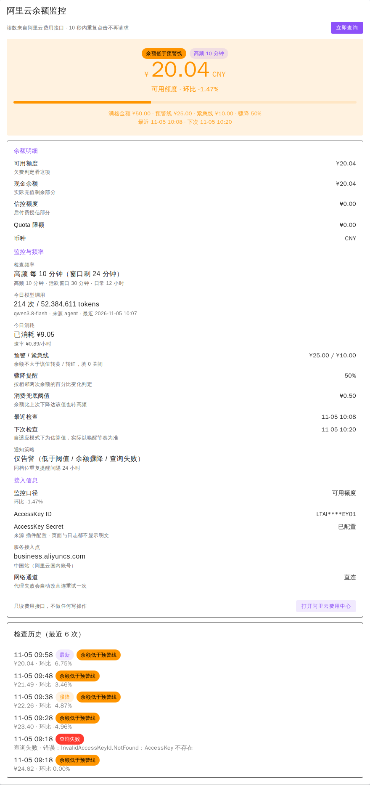
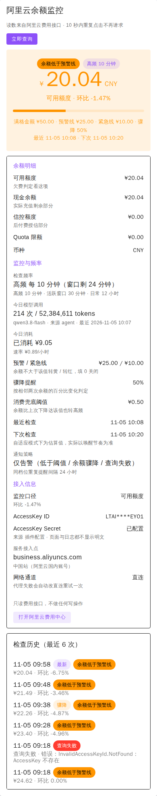
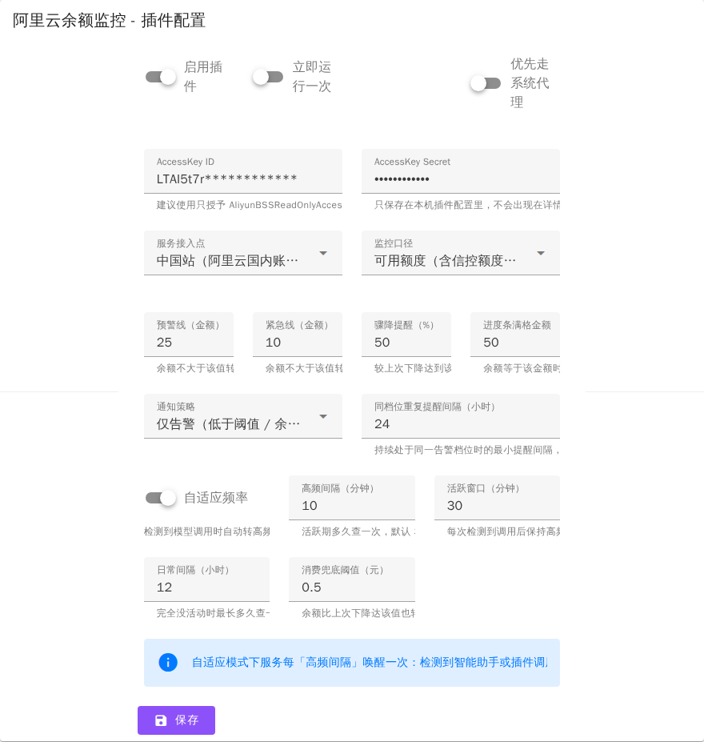

# 阿里云余额监控

监控阿里云账户的可用额度与现金余额，在智能助手调用大模型时自动转为高频检查，余额低于阈值、骤降或查询失败时推送通知。插件只调用阿里云费用中心的只读接口，不做任何写操作。

| 项目 | 值 |
| --- | --- |
| 插件 ID | `AliyunBalance` |
| 插件目录 | `plugins.v2/aliyunbalance` |
| 索引 | `package.v2.json`（V2 代次索引，本实例 MoviePilot v3.2.2 实测可用） |
| 本文档对应版本 | `1.6.10` |
| 权限等级 | `auth_level = 1`（进入插件页需要管理员登录态） |
| 作者 | 左岸 |
| 数据来源 | 阿里云 BssOpenApi `QueryAccountBalance`（版本 `2017-12-14`） |
| 写操作 | 无 |

> 目录
>
> - [快速上手](#快速上手)
> - [工作原理](#工作原理)
> - [界面说明](#界面说明)
> - [配置项详解](#配置项详解)
> - [通知与告警规则](#通知与告警规则)
> - [命令与接口](#命令与接口)
> - [常见问题](#常见问题)
> - [数据与安全](#数据与安全)
> - [版本变更](#版本变更)

---

## 快速上手

1. 在插件设置里打开 **启用插件**，填写 **AccessKey ID / Secret**。建议单独建一个 RAM 用户，只授予费用中心只读权限 `AliyunBSSReadOnlyAccess`。
2. 国际站账号（alibabacloud.com）把 **服务接入点** 改成 `business.ap-southeast-1.aliyuncs.com`，中国站保持默认。
3. 保存后在详情页点 **立即查询**，或发送 `/aliyunbalance`，当场确认读数与通知渠道都通。
4. 设 **预警线** / **紧急线**：余额不大于该值时转黄、转红，填 `0` 表示关闭该项。
5. 想让进度条反映「这次充值还剩多少」，填 **进度条满格金额**；留空则进度条继续按预警线计算。
6. 保持 **自适应频率** 开启即可，不需要手写 cron。

不想把密钥写进插件配置（配置明文存库）：在容器环境变量里设置 `ALIBABA_CLOUD_ACCESS_KEY_ID` 与 `ALIBABA_CLOUD_ACCESS_KEY_SECRET`，两个配置项留空即自动回退读取。详情页的 **AccessKey Secret** 一行会标注当前来源是「插件配置」还是「环境变量」。

---

## 工作原理

### 读数

- 调用 `QueryAccountBalance`，用标准库按阿里云 RPC 签名机制（HMAC-SHA1、`SignatureVersion 1.0`）实现签名，不引入官方 SDK，插件无额外依赖。
- 取回并展示的字段：`AvailableAmount`（可用额度，含信控额度，欠费判定看这项）、`AvailableCashAmount`（现金余额，实际充值剩余部分）、`CreditAmount`（信控额度）、`QuotaLimit`（Quota 限额）与币种。
- **监控口径** 决定用哪一项做阈值判定、进度条与告警：默认「可用额度」，可切到「现金余额」。
- 单次请求超时 15 秒。开启 **优先走系统代理** 时，代理失败会自动改用直连再试一次；已应答的业务错误不会换通道重试（避免重复消耗与撞流控）。

### 检查节奏（自适应）

插件注册一个固定「高频间隔」唤醒的后台服务，**是否真的打接口由闸门判断**：

- 活跃窗口内，且距上次检查 ≥ `0.9 × 高频间隔` → 查询；
- 窗口外，且距上次成功检查 ≥ **日常间隔** → 查询；
- 其余情况只写一条 debug 跳过日志，不调用阿里云接口。

三个信号会打开或顺延活跃窗口（窗口时长 = **活跃窗口** 设置值）：

1. **轮初信号**：宿主每轮智能助手建图前广播的 `agent.llm.provider` 链式事件。它发生在任何 token 消耗之前，所以长任务不必等到整轮跑完才被盯上。插件只读取「有没有这个事件」，不修改事件内容，也不读取其中的密钥字段。
2. **轮末用量事件**：宿主在一轮执行结束时广播的 `agent.tokens.usage`，载荷是整轮聚合的调用次数与 token 数。调用次数与 token 都为 0 的事件（例如执行前就失败）不算活跃。
3. **消费兜底**：相邻两次余额下降达到 **消费兜底阈值** 时也续窗，用来覆盖不是 MoviePilot 发起的消耗。

节奏一律以「距上次执行的时间」为准，而不是「被唤醒了几次」——插件每次热重载都会按启动时间提前唤醒一轮，只看窗口会把间隔压成几十秒一次。

### 状态与告警

- 档位：`normal` 余额充足 / `warn` 低于预警线 / `critical` 低于紧急线 / `unknown` 状态未知 / `error` 查询失败。
- 骤降：本次余额相比**上一次读数**下降百分比 ≥ **骤降提醒** 即触发。
- 去重：告警指纹是「档位 + 是否骤降」。同一指纹按 **同档位重复提醒间隔** 重复提醒；档位变化（新进入告警、warn 升级到 critical、或恢复正常）立即发送；查询失败、骤降、手动查询不受去重限制。
- 查询失败时卡片与详情页会保留最后一次成功读数并标注「数据已滞后」，不会一次失败就整页空白。

---

## 界面说明

### 首页仪表盘卡片


从上到下：阿里云标识 → 大号余额读数 + 状态徽章 → 进度条与口径说明 → 今日消耗与速率 → 分隔线 → 检查节奏与相对时间。

- **点标识可打开插件**：在新标签页打开本插件详情页（宿主插件页深链 `#/plugins?id=AliyunBalance`），仪表盘原页面不动。浏览器拦截新标签时不会跳转。
- **进度条口径**：填了「进度条满格金额」就按该金额计算并显示「相对满格金额 ¥50.00 40%」；未填则沿用「相对预警线」。颜色只反映最后已知读数的档位，查询失败不会用红色涂满一根条。
- **检查节奏**：高频时显示「高频 10 分钟（剩 24 分）」，窗口外显示「日常 12 小时」，关闭自适应则显示「固定周期」。
- 尚无读数时，卡片显示引导：去详情页点「立即查询」或等自动检查。

### 插件详情页





- 顶部 **立即查询**：当场查一次并刷新页面，10 秒内重复点击不再发请求。
- **状态主卡**：状态与频率徽章、大号余额、监控口径与环比、进度条、阈值说明、最近/下次检查时间。
- **余额明细**：可用额度、现金余额、信控额度、Quota 限额、币种。
- **监控与频率**：当前节奏（高频/日常参数一并列出）、今日模型调用次数与 token 用量及模型与来源、今日消耗与速率、预警/紧急线、骤降提醒、消费兜底阈值、最近与下次检查、通知策略。
- **接入信息**：监控口径与环比、AccessKey ID（只显示首尾 4 位）、Secret 来源、服务接入点、网络通道。
- **检查历史**：默认展示最近 10 条、本地保留 60 条，每行带状态徽章，最新一条标「最新」，骤降与查询失败单独标注并给出当时的错误原因。

### 设置页



> 界面图说明：以上图片由插件自身的 `get_dashboard` / `get_page` / `get_form` 渲染数据，在与宿主同版本的 Vuetify（MoviePilot v3.2.2 前端）环境下渲染截图得到，数值为演示数据，AccessKey 按插件的脱敏规则显示，不含真实凭据。

---

## 配置项详解

| 配置项 | 默认 | 说明 |
| --- | --- | --- |
| 启用插件 | 关 | 关闭后不再注册服务、不出现在仪表盘卡片 |
| 立即运行一次 | 关 | 一次性动作，执行后自动复位，避免每次保存都跑一轮 |
| 执行周期 | `0 9,21 * * *` | 仅在关闭自适应频率时生效 |
| 优先走系统代理 | 开 | 代理失败自动改直连重试一次 |
| AccessKey ID / Secret | 空 | 留空时回退读环境变量；建议只用费用只读权限的 RAM 用户 |
| 服务接入点 | 中国站 | 国际站账号必须改 `business.ap-southeast-1.aliyuncs.com` |
| 监控口径 | 可用额度 | 决定阈值判定、进度条与告警看哪一项 |
| 预警线（金额） | `100` | 余额不大于该值转黄，`0` 关闭 |
| 紧急线（金额） | `20` | 余额不大于该值转红，`0` 关闭 |
| 骤降提醒（%） | `0` | 相比上一次读数下降达该百分比即告警，`0` 关闭 |
| **进度条满格金额** | `0` | 余额等于该金额时进度条画满；留空或 `0` 回退按预警线计算 |
| 通知策略 | 仅告警 | 可选「每次检查都汇报」 |
| 同档位重复提醒间隔（小时） | `24` | 持续处于同一告警档位时的最小提醒间隔，`0` 为每次都发 |
| 自适应频率 | 开 | 关闭后回到按 cron 固定查询 |
| 高频间隔（分钟） | `30` | 活跃期多久查一次，下限 1 分钟 |
| 活跃窗口（分钟） | `60` | 每次检测到活动后保持高频的时长，不小于高频间隔 |
| 日常间隔（小时） | `12` | 完全没有活动时的最长读数间隔，下限 1 小时 |
| 消费兜底阈值（元） | `0.5` | 余额比上次下降达该值也转高频，`0` 关闭 |

数值项都做了安全解析与钳制：`"7.5"`、`1,000.5`、全角数字可正常识别，非法值、空值与负数按未设置处理，不会导致配置保存或插件加载失败。

---

## 通知与告警规则

告警正文由插件渲染，标题已经说明档位，正文只给一次余额读数、消耗与速率、触发条件与检查时间。以下为各情形的实际文案：

```text
⚠️【阿里云余额监控】余额低于预警线
可用额度：¥24.62（较上次 -2.46%）
今日消耗：¥4.47（速率 ¥0.35/小时）
触发：低于预警线 ¥25.00
检查时间：2026-11-02 12:53

🔴【阿里云余额监控】余额低于紧急线
可用额度：¥8.20（较上次 -2.46%）
今日消耗：¥20.89（速率 ¥1.64/小时）
触发：低于紧急线 ¥10.00
检查时间：2026-11-02 12:53

⚠️【阿里云余额监控】余额骤降提醒
可用额度：¥60.00（较上次 -52.00%）
今日消耗：¥0.00（速率 ¥0.00/小时）
触发：较上次下降 52.00%（阈值 50%）
检查时间：2026-11-02 12:53

🔴【阿里云余额监控】查询失败
错误：InvalidAccessKeyId.NotFound：AccessKey 不存在
接入点：中国站（阿里云国内账号）（business.aliyuncs.com）
排查建议：确认 AccessKey 有效且已授权费用只读权限；国际站账号需把接入点改为
business.ap-southeast-1.aliyuncs.com；网络受限可切换「优先走系统代理」。
检查时间：2026-11-02 12:53
```

- 通知策略为「仅告警」时，只有低于阈值、骤降、查询失败以及从告警恢复正常会推送；「每次检查都汇报」则每轮都发。
- 进度条口径（满格金额）只用于界面，不会出现在告警里。

---

## 命令与接口

- 斜杠命令 `/aliyunbalance`：立即查询一次余额并把读数推送到通知渠道（走宿主 `PluginAction` 事件，动作 `aliyunbalance_refresh`）。
- 插件接口 `GET /api/v1/plugin/AliyunBalance/refresh`：详情页「立即查询」按钮使用，需要登录态（bearer），带 10 秒冷却，重复点击不会重复请求。

---

## 常见问题

**余额明明在降，为什么没及时提醒？**
三层延迟叠加：阿里云出账本身滞后（百炼推理分钟级，通常 2~10 分钟）、读数节奏（活跃窗口内约一个高频间隔，窗口外受日常间隔限制）、告警只在读数时刻判定。想更灵敏就调小高频间隔与日常间隔。

**其它插件或外部程序调用大模型，会转高频吗？**
不会。轮初与轮末两个信号只覆盖 MoviePilot 智能助手；自带模型客户端的插件（字幕翻译、名称识别等）直接请求厂商接口，宿主没有用量事件可订阅。这类消耗只能靠「消费兜底」在下一次读数时发现，所以**把日常间隔从默认 12 小时调小**是覆盖它的主要手段。真正能挡住扣穿的是阿里云侧的消费限额与余额预警，插件读数天然是滞后信号。

**为什么同档位只收到一条提醒？**
同档位按「同档位重复提醒间隔」去重（默认 24 小时）。档位变化（预警线 → 紧急线、恢复正常）会立即发送，骤降与查询失败也不受去重限制。希望持续提醒就把该间隔调小。

**「进度条满格金额」和预警线有什么区别？**
预警线是**告警阈值**，决定是否转黄；满格金额只是**进度条基准**，决定 100% 对应多少钱，不影响任何告警判定。填了满格金额，进度条就不再按预警线折算。

**为什么没有「预计续航」了？**
1.6.10 起移除。它靠「当日首次读数 + 线性速率」外推，而账户里同时存在充值、信控扣款与包年包月出账，读数本就不连续，算出的小时数容易误导。现在保留更硬的「今日消耗 + 速率」。

**点卡片上的阿里云标识没反应？**
它在新标签页打开插件详情，浏览器拦截弹出窗口时不会跳转；另外插件页需要管理员登录态，普通用户账号会被拦在权限外。

**首次配置报 `InvalidAccessKeyId.NotFound`？**
这是 AccessKey 不存在或已被删除，属服务端已应答的业务错误，插件不会换通道重试。请核对 RAM 用户的 AccessKey 与所属站点（中国站/国际站接入点不同）。

**国际站账号读不到数据？**
把「服务接入点」改为 `business.ap-southeast-1.aliyuncs.com`（对应 `ap-southeast-1`），中国站账号反之不要用国际接入点。

---

## 数据与安全

- 调用的是阿里云费用中心只读接口 `QueryAccountBalance`，插件不发起任何写操作。
- AccessKey 只保存在本机插件配置中；详情页与日志都不输出 Secret 明文，AccessKey ID 仅显示首尾各 4 位。
- 检查历史保存在插件自有数据（`balance_history` 键，本地保留 60 条、详情页展示 10 条），配置与最近读数保存在插件实例配置中。卸载插件本体时这两者都保留，重装后配置依旧生效；卸载分身实例时会连同配置与数据一起删除，迁移前请自行备份。
- 轮初信号会订阅宿主的 `agent.llm.provider` 链式事件，插件只判断事件是否发生，不读取也不记录其中的凭据字段。

---

## 版本变更

| 版本 | 变更 |
| --- | --- |
| `1.6.10` | 移除预计续航：卡片、详情页和告警都不再显示续航，只留今日消耗与速率 |
| `1.6.9` | 告警消息重排：不再重复余额和状态，阈值行只留本次触发的条件，进度条口径不进通知 |
| `1.6.8` | 大模型一开始被调用就转高频盯余额，不用等整轮任务跑完才收到通知 |
| `1.6.7` | 新增「进度条满格金额」；点卡片上的阿里云标识会新开标签页打开本插件 |
| `1.6.6` | 恢复宽版标识的完整橙色边距 |

完整更新说明见 `package.v2.json` 中 `AliyunBalance.history`。
