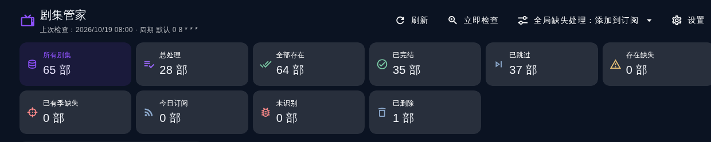

# 剧集管家

检测媒体库里的电视剧缺了哪些季、哪些集，按你定的策略自动补订阅；剧集从媒体服务器删除后会自动留档，等它出新季时可以一键继续追更。

| 项目 | 值 |
| --- | --- |
| 插件 ID | `GetMissingEpisodes` |
| 插件目录 | `plugins.v2/getmissingepisodes` |
| 本文档对应版本 | `3.2.8` |
| 适用 MoviePilot | V3 |
| 权限等级 | 2（需要登录态，会写订阅） |
| 上游作者 | 左岸 |

> 目录
>
> - [快速上手](#快速上手)
> - [工作原理](#工作原理)
> - [界面说明](#界面说明)
> - [配置项详解](#配置项详解)
> - [缺失处理方式](#缺失处理方式全局与单剧)
> - [清理检查记录（分级）](#清理检查记录分级)
> - [已删除剧集与继续追新](#已删除剧集与继续追新)
> - [记录状态与统计口径](#记录状态与统计口径)
> - [扫描摘要与页面轮询](#扫描摘要与页面轮询)
> - [常见问题](#常见问题)
> - [数据来源与接口](#数据来源与接口)
> - [版本变更](#版本变更)

---

## 快速上手

1. 安装后在插件设置里打开**启用插件**，勾上**显示侧边栏入口**，主界面左侧「订阅」分组里会出现「剧集管家」。
2. 第一次跑，把**全局缺失处理方式**保持默认的「仅检查记录」，点顶栏**立即检查**跑一轮。
3. 打开**已跳过**以外的页签逐张看卡片，把你不想自动补全的剧点**跳过**，或点选某几季再点**标记存在**。
4. 标记错了不用再删记录：卡片上的**已忽略季**标签点一下就撤销。
5. 确认记录干净了，再把**全局缺失处理方式**改成「添加到订阅」，之后每轮扫描就会自动补订缺失的季。
6. 需要限定范围时填**媒体服务器名称白名单**和**电视剧媒体库白名单**，留空表示全部。

插件自身也给了同样的提醒：首次检测建议先用「仅检查记录」，按记录手动跳过无需检测的剧集后再改为「添加到订阅」，可避免因 TMDB 信息错误产生误订阅。

---

## 工作原理

每一轮扫描（定时任务或点「立即检查」）按下面的顺序走：

1. **枚举媒体库**：取出已配置的媒体服务器（Emby / Jellyfin / Plex 等，可用名称白名单筛选），逐个取其电视剧媒体库（可用库名白名单筛选），列出库里的条目。
2. **识别身份**：条目必须是电视剧，并且能拿到 TMDB ID（媒体服务器侧的 Provider IDs）。拿不到的记为**未识别**，不参与缺失计算。
3. **取库里实际有的集**：向媒体服务器查询该条目每一季已存在的集号，作为「已存在快照」。
4. **取 TMDB 应有的集**：向 TMDB 请求该季详情，一次请求同时算出「筛选后应订阅的集」和「实际总集数」（`3.2.8` 之前是两次请求）。开启**仅订阅已开播剧集**时，播出日期还没到的集不计入；**特季 S00** 默认不检测。
5. **比对出缺失**：逐季比较，TMDB 有、库里没有的集记为缺失。以下情况整季跳过：已在忽略季列表里、该季已存在订阅。
6. **按策略处理**：没有任何缺失 → 状态记为**全部存在**；有缺失 → 状态记为**存在缺失**，再按该生效的「缺失处理方式」执行（只记录 / 直接订阅 / 把缺失季标记为存在）。订阅成功记为**已加订阅**。
7. **归档同步**：本轮不再出现的记录，先向媒体服务器复核该条目是否真的不存在了，确认后才转入**已删除**留档；复核失败或该服务器本轮没扫完，一律保持原样，不会误归档。
8. **追新检测**：对已归档且开了**继续追新**的剧，用归档时留的「删除前存在季集」作基线查 TMDB，把新季和当时没看全的季按缺失处理（详见[已删除剧集与继续追新](#已删除剧集与继续追新)）。
9. **落库节流**：整份记录不再每处理完一部剧就全量写一次，而是每累计 10 条变更写一次、扫描收尾必写一次。
10. **写入扫描摘要**：本轮的用时与各项计数存到独立数据键 `scan_summary`，标题栏直接显示（见[扫描摘要与页面轮询](#扫描摘要与页面轮询)）。

**并发保护**：定时检测与手动「立即检查」共用一把单飞闸门，同一时刻只会有一条检测在跑；后到的一方直接跳过并记日志（`已有检测在进行中，跳过本轮定时检测`）。此前两条线程会各自读整份记录再整份写回，后完成的会覆盖先完成的成果。

记录的键是 `媒体服务器_媒体库ID_条目ID_标题`。同一部剧换库、重建库或改名都会生成新条目 ID，因此插件额外按 TMDB ID 做了一层识别：同剧以新条目重新入库时，会把旧记录里的忽略季、首次发现时间并到新记录，并清掉旧键，避免一部剧同时出现两条记录。

---

## 界面说明



> 截图为较早版本，`3.2.8` 新增的「排序」下拉与扫描摘要见下文说明。

**顶部栏**

| 控件 | 作用 |
| --- | --- |
| 刷新 | 重新读取看板数据，不触发检测 |
| 立即检查 | 后台跑一轮完整扫描，跑完自动刷新页面；已有检测在跑时不会重复起第二条 |
| 全局缺失处理：xxx ▾ | 直接切换全局缺失处理方式，选中即保存，不必进设置弹窗 |
| 排序：xxx ▾ | 卡片列表排序，可选**状态变化时间**（默认）、最近检查、最后播出、开播年份、评分、剧名；选择记在本浏览器，不随账号同步 |
| 设置 | 打开完整设置弹窗 |

标题栏第二行是状态与摘要：`上次检查：… · 周期 … · 上轮扫描 … · 用时 … 秒 · 检测 N 部 · 跳过 N 部 · 缺失 N 部 · 订阅 N 部 · 归档 … · 追新 …`，为零的计数会自动省略。

**统计卡同时也是筛选页签**，点一下就在下方只显示这一类记录，工具栏同时显示「当前页签 · 共 N 部」，再点一次或点「所有剧集」回到全量。口径见[记录状态与统计口径](#记录状态与统计口径)。

**剧集卡片**


卡片从上到下：海报、剧名（点击跳媒体详情页）、**来源：媒体服务器 · 媒体库**、状态徽章（全部存在 / 存在缺失 / 已加订阅 / 已删除 / 追新中 / 已跳过）、剧集状态（TMDB 的播出中、已完结、已取消…）、开播年份与评分、最后播出日期、本轮检查时间。信息区背后铺一张该剧的横版背景图，文字仍在不透明底色上。

有缺失时列出缺失季标签，**点标签即可选中/取消**：

- 选中后按钮变成 `标记存在(N)`，只把**选中的季**写入忽略季；
- 不点选直接按按钮会提示「请先点选要标记为已存在的缺失季」，不会整条一键全标；
- 之前被忽略的季单独列在「已忽略季」一行，**点一下就撤销**，下一轮扫描重新评估该季。

归档卡片会多出「删除时间」「删除前存在」「追新结果」三行。

底部是操作按钮，最后一行是该剧专属的**缺失处理**下拉：

| 按钮 | 出现条件 | 作用 |
| --- | --- | --- |
| 删除记录 | 所有卡片 | 删掉这条检查记录（只删记录，不动媒体库和订阅） |
| 标记存在(N) | 存在缺失 / 已加订阅 | 把点选的缺失季写进忽略季，之后不再当缺失，未选中的季继续按缺失处理 |
| 订阅缺失 | 存在缺失 | 立即按缺失季添加订阅 |
| 跳过 / 取消跳过 | 所有卡片 | 跳过＝不再检测这部剧；取消后恢复 |
| 继续追新 / 停止追新 | 已删除卡片 | 打开后每轮扫描会检查这部剧的新季 |
| 缺失处理：全局 ▾ | 所有卡片 | 给这一部剧单独指定缺失处理方式，选「跟随全局」即取消单独设置 |


**分页**：桌面每页 24 部、紧凑视图 12 部，顶部与底部都有页码条，底部分页左侧显示「共 N 部 · 第 X/Y 页」，翻页后自动回到列表顶部。

手机端是同一套界面，卡片单列排布：


---

## 配置项详解


| 配置项 | 默认 | 说明 |
| --- | --- | --- |
| 启用插件 | 关 | 关闭后不再定时扫描，页面仍可看历史记录 |
| 显示侧边栏入口 | 开 | 在主界面左侧「订阅」分组显示入口 |
| 仅订阅已开播剧集 | 开 | TMDB 播出日期未到的集不计入缺失，避免为没播的集订阅 |
| 仅检查已有季缺失 | 开 | 只检查库里已有的季缺不缺集；关闭后库里完全没有的季也算缺失（会整季补订） |
| 自动跳过已完结剧集 | 关 | TMDB 状态为「已完结」时自动置为跳过。TMDB 状态可能误标，出现漏检时手动取消跳过 |
| 包含 S00 季检测 | 关 | 打开后特别季（S00）也参与缺失检测 |
| 立即运行一次 | 关 | 保存配置时立刻跑一轮。**注意：开着它每次改配置都会真跑一轮扫描**，若全局缺失处理方式是「添加到订阅」，就会真的产生订阅 |
| 清理检查记录 | 关 | 保存时按**清理范围**移除记录，触发后自动复位，详见[清理检查记录（分级）](#清理检查记录分级) |
| 执行周期 | 空 | 5 位 cron，留空按 `0 8 * * *` 每天 08:00。MoviePilot 的定时任务星期字段是 `周一=0…周日=6`，`0 9 * * 1` 表示周二 09:00，按星期跑建议直接写英文名（`mon`、`sun`） |
| 全局缺失处理方式 | 仅检查记录 | 见下一节 |
| 媒体服务器名称白名单 | 空 | 留空＝全部已配置的媒体服务器；多个名称用英文逗号分隔 |
| 电视剧媒体库白名单 | 空 | 留空＝全部电视剧库；按库名匹配 |
| 下载路径替换 | 空 | 一行一条 `媒体库路径:订阅保存路径`，命中前缀时替换后作为订阅的保存目录 |

设置弹窗之外还有两个可保存字段（**清理范围**、**未更新天数**），见下一节。

---

## 缺失处理方式（全局与单剧）

「发现缺失之后做什么」有三档：

| 方式 | 行为 | 结果状态 |
| --- | --- | --- |
| 仅检查记录 | 只把缺失记下来，不动订阅 | 存在缺失 |
| 添加到订阅 | 按缺失季自动添加订阅，交给订阅流程下载补全 | 已加订阅（订阅失败时仍记为存在缺失） |
| 标记为存在 | 把本轮缺失季并入忽略季，等于宣告这些季不再需要补全 | 全部存在 |

两个入口：

- **全局**：顶栏「全局缺失处理」下拉，或设置弹窗里的「全局缺失处理方式」。改完立即保存，下一轮扫描生效。
- **单剧覆盖**：卡片底部「缺失处理」下拉。给某一部剧单独指定后，它就不再跟全局走；选「跟随全局」恢复。适合"整体自动订阅，但某几部 TMDB 集数混乱的剧别自动订"这类情况。

单剧覆盖只改变**发现缺失之后做什么**，不影响是否检测：想彻底不检测某部剧请用**跳过**；只想放过某几季请用**标记存在**。

---

## 清理检查记录（分级）

`3.2.8` 起，「清理检查记录」不再只能一键全清，可按范围移除：

| 清理范围 | 移除哪些记录 |
| --- | --- |
| `all`（默认） | 全部记录，含已删除留档，不可恢复 |
| `skipped` | 只清已跳过的记录 |
| `deleted` | 只清已删除归档 |
| `stale` | 只清长期未更新的记录，阈值由**未更新天数**决定（默认 90 天，最小 1 天） |

`stale` 依据记录的最后完整检查时间，没有该字段时退回状态变更时间；两者都解析不出时间的记录不动。范围命中 0 条时会记一条「没有符合条件的记录」，不会误清。

当前设置弹窗只有「清理检查记录」这个开关，**范围下拉尚未在界面上暴露**，需要时通过接口写入一次即可长期生效：

```
POST /api/v1/plugin/GetMissingEpisodes/settings
{"clear": true, "clear_scope": "skipped", "clear_stale_days": 180}
```

开关触发后自动复位，下一次保存不会再清。范围字段会一直留在配置里，下次再打开开关仍按同一范围清理。

---

## 已删除剧集与继续追新

在媒体服务器里删掉一部剧之后，插件下一轮扫描发现它不见了，会先向媒体服务器复核该条目确实已消失，然后把它转入**已删除**留档，而不是直接丢掉记录。


归档记录保留：剧名、年份、TMDB ID、来源服务器与媒体库、海报与评分、删除时间、最后一次在库的检查时间，以及最关键的**删除前存在的季与集快照**和此前的忽略季。

归档后的三种状态：

| 状态 | 是否检测 | 是否计入「总处理」 |
| --- | --- | --- |
| 刚归档、没开追新 | 不检测（静默留档，零请求） | 不计入 |
| 开了「继续追新」 | 每轮扫描按基线查新季 | 计入 |
| 点「删除记录」 | 档案彻底移除，之后再入库按新条目重新建档 | 不计入 |

点「继续追新」会顺带取消这部剧的跳过标记——主动追新说明你重新开始管它，不跳过才会计入总处理并参与检测；停止追新后，跳过状态不会自动恢复。

**继续追新的判定**：以归档时的季集快照为基线，只认「基线之外」的季为需要补的新内容。

- 某季当时在库里是完整的 → 不再打扰；
- 某季当时就不全（例如库里只有 1-5 集，TMDB 有 8 集）→ 判定为缺失；
- TMDB 上新出的季 → 判定为缺失。

判定出的缺失季**按整季订阅**：MoviePilot 的订阅粒度是「一部剧的一季」，没有"只订某几集"的入口，所以缺失季会整季找回，包括当初被一起删掉的集。卡片上的「缺失处理」下拉和全局方式决定它是只记录、直接订阅，还是标记为存在。

重新入库会自动出列：同一条目重新回到库里，或同 TMDB ID 换了新条目 ID 回来，归档记录都会并回常规检测列表，忽略季与首次发现时间一并带回，不会留下重复记录。

「清理检查记录」在 `all` 范围下会连这些归档一起清空，动手前请先确认；只想清归档请用 `deleted` 范围。

---

## 记录状态与统计口径

单条记录的状态（卡片徽章）：

| 状态 | 含义 |
| --- | --- |
| 全部存在 | 本轮检测没有缺失 |
| 存在缺失 | 检出缺失，且没有自动订阅（或订阅失败） |
| 已加订阅 | 本轮已按缺失季添加订阅 |
| 未识别 | 拿不到 TMDB ID 或不是电视剧，无法比对 |
| 已删除 | 已从媒体库删除并留档 |

统计卡（同时是筛选页签）：

| 统计卡 | 口径 |
| --- | --- |
| 所有剧集 | 全部记录，含已删除留档 |
| 总处理 | 未跳过，且（未归档 或 已开追新）的记录，即"当前真正处于纳管状态"的剧数 |
| 全部存在 | 状态＝全部存在 |
| 已完结 | TMDB 剧集状态为已完结 |
| 已跳过 | 跳过标记为真（含「自动跳过已完结剧集」命中的） |
| 存在缺失 | 状态＝存在缺失 |
| 已有季缺失 | 状态＝存在缺失，且确实列出了具体缺失集 |
| 今日订阅 | 状态＝已加订阅 |
| 未识别 | 状态＝获取失败 |
| 已删除 | 归档记录数 |

因此有：`所有剧集 = 总处理 + 已跳过 + 未开追新的归档记录`。

---

## 扫描摘要与页面轮询

**扫描摘要**每轮结束时写入独立数据键 `scan_summary`，不参与整本记录读写，也不会因摘要字段让记录变胖。字段含义：

| 字段 | 含义 |
| --- | --- |
| `time` | 本轮开始时间 |
| `duration` | 本轮用时（秒，保留 1 位小数） |
| `library_items` | 本轮枚举到的库内条目数 |
| `checked` | 实际检测数＝全部存在＋存在缺失＋已加订阅＋获取失败（不含跳过） |
| `skipped` / `missing` / `subscribed` / `failed` | 跳过、检出缺失、已订阅、获取失败的部数 |
| `archived` / `revived` / `renamed` | 本轮新归档、归档出列、换条目 ID 合并的条数 |
| `follow_checked` / `follow_subscribed` | 追新检测、追新订阅的部数 |

写失败只降级为日志，不影响检测结果。

**页面轮询**：检测进行中每 6 秒请求一次 `GET /status?summary=1`，只回运行标志、统计与上次检查时间（约 0.3 KB，全量看板约 70 KB），不再每次重复枚举媒体库；浏览器标签页切到后台时不发请求；检测到跑完后自动拉一次整表刷新界面。

---

## 常见问题

**某部剧一直报缺失，其实已经看完了。** 多为 TMDB 的集数/分季与实际发布不一致（特别季、合集、分季方式不同）。用卡片上的**标记存在**把那些季并入忽略季；根因在识别侧的话，配合 MoviePilot 的自定义识别词或 TMDB 剧集组更彻底。

**标记错了想撤销。** 直接点卡片「已忽略季」里的对应季标签即可撤销，下一轮扫描重新评估该季。撤销只清忽略标记，不回填缺失快照——那轮缺失要等下次扫描重新算出来。

**不想让它自动订阅某几部剧。** 优先用卡片底部的**缺失处理**下拉给该剧单独设成「仅检查记录」；整部剧都不想管就用**跳过**。

**点了「立即检查」页面没变化。** 检测在后台线程跑，跑完才刷新看板；库大时每季都要查一次 TMDB，耗时较长。看标题栏「上轮扫描」时间和摘要里的用时是否已更新。

**同时点定时检查和手动检查会不会打架。** 不会。两者共用单飞闸门，后到的一方直接跳过并在插件日志里留一行提示。

**改了配置意外产生了一批订阅。** 检查是否同时开着**立即运行一次**和「添加到订阅」——保存配置会立刻跑一轮，这是真执行，不是演练。

**删掉的剧没有进「已删除」。** 三种正常情况：所属媒体服务器本轮没扫完（例如服务器临时不可达）、复核时条目仍在库里、条目刚消失但复核请求失败。插件宁可漏归档也不误归档。

**开了追新却没订阅新季。** 依次确认：该剧的**缺失处理**是否被单独设成「仅检查记录」；新季是否其实已在忽略季列表里；该季是否已存在订阅；卡片「追新结果」行显示的具体原因。

**多套媒体服务器里有同名剧，分不清是哪来的。** 卡片第二行的「来源：媒体服务器 · 媒体库」就是为此加的。`3.2.8` 之前建的老记录没有这两个字段，下一轮扫描会自动回填；跳过的记录同样会回填所属服务器。

**换库/重建库后出现重复记录。** 同 TMDB ID 的旧记录会自动清理并把忽略季、首次发现时间并到新记录，一般无需手动处理。摘要里的「换ID」计数就是本轮合并掉的条数。

**记录存在哪里。** 插件自有存储（数据库 `plugindata` 表，`plugin_id=GetMissingEpisodes`、`key=history`，扫描摘要另存于 `key=scan_summary`）。卸载或「清理检查记录」都会丢失，需要长期留档请自行备份。

---

## 数据来源与接口

页面数据来自插件自定义接口 `GET /api/v1/plugin/GetMissingEpisodes/status`，返回统计、记录列表、当前配置、媒体库/媒体服务器候选项与最近一次扫描摘要；按钮逐个对应一个接口（均需登录态，服务端调用可带 `apikey`）：

| 接口 | 方法 | 作用 |
| --- | --- | --- |
| `/status` | GET | 工作台总览数据；带 `?summary=1` 时只回统计与运行标志，供轮询 |
| `/settings` | POST | 保存配置（顶栏全局缺失处理、清理范围也走这里） |
| `/run` | POST | 立即执行一次检测 |
| `/set_history_type` | GET | 切换当前筛选页签 |
| `/delete_history` | GET | 删除单条记录 |
| `/set_all_exist_history` | GET | 标记存在，`seasons` 传逗号分隔季号，写入忽略季 |
| `/unset_ignored_season_history` | GET | 撤销忽略季，`seasons` 留空表示撤销全部已忽略季 |
| `/add_subscribe_history` | GET | 订阅缺失季 |
| `/toggle_skip_history` | GET | 切换跳过 |
| `/toggle_follow_history` | GET | 切换已删除剧集的继续追新 |
| `/set_action_history` | GET | 设置单剧缺失处理方式，空值表示跟随全局 |

---

## 版本变更

| 版本 | 变更 |
| --- | --- |
| `3.2.8` | 已忽略季可点撤销；新增分级清理范围与未更新天数；标题栏显示上轮扫描摘要；卡片标注来源服务器与媒体库；工具栏新增排序；每季 TMDB 详情请求由 2 次合并为 1 次 |
| `3.2.7` | 修复定时检测与手动「立即检查」可能并发、互相覆盖历史记录的问题；检测过程中不再每部剧全量写库；页面轮询改用轻量返回 |
| `3.2.6` | 剧集卡片信息区新增横版背景图 |
| `3.2.5` | 卡片列表下方新增页码条，底部翻页后自动回到列表顶部 |
| `3.2.4` | 修复剧名点击无法跳转媒体详情页的问题 |
| `3.2.3` | 「标记存在」改为按季点选，只标记选中的季；修复卡片操作不显示后端返回提示 |
| `3.2.2` | 新增详细使用说明 |
